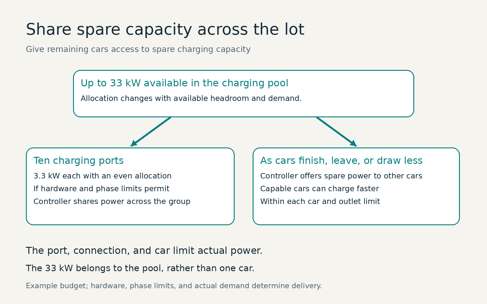
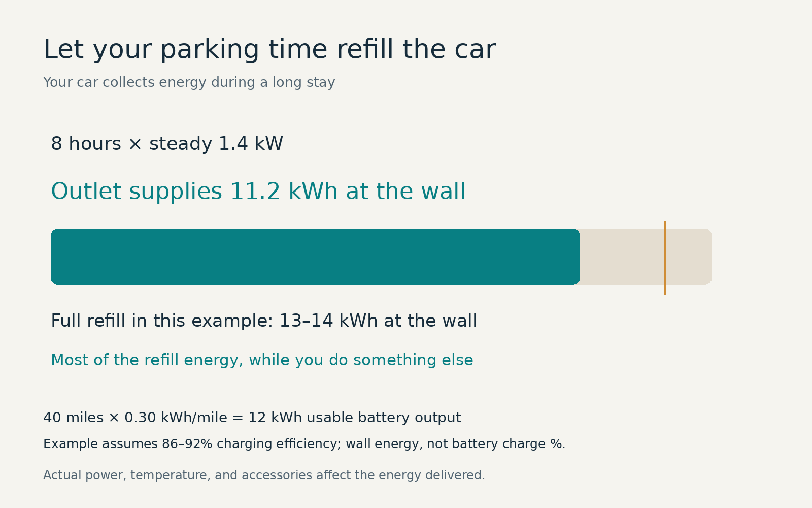

Most cars sit for hours every day—at work, at home, overnight. That time is already spent. A plug beside the space can turn some of it into useful energy without forcing the car to haul a giant battery everywhere it goes.

Don’t size the battery for the longest trip. Size it for the trips you make regularly, and refill it while the car is parked.

That idea has a name: **distributed electrification**. Many vehicles carry modest packs for ordinary days. Slow, managed outlets use parking time that already exists. An efficient hybrid drivetrain keeps the long trip. Managed charging can limit expensive electrical upgrades. Electricity displaces petroleum where it makes sense. Liquid fuel stays as a second energy path. This is a system argument, not a claim that plug-in hybrids should replace battery-electric cars.

## Why a smaller battery helps

A smaller pack uses less battery material, weighs less, and costs less than a larger pack with comparable chemistry and engineering. You carry that pack on every mile. Count the engine and fuel system too when you compare whole cars. The pack saving is not the whole purchase decision.

Daily trips can run on electricity when it makes sense. Fuel covers travel beyond the grid charge. Regenerative braking, motor assistance, and reduced idling save fuel even on days you never plug in. Charging adds electric miles on top of those hybrid gains.

For your household, the battery gets a regular job without taking responsibility for every trip. A dependable plug at home or work can replenish it between journeys. Your routes, weather, and available charging decide how much of your driving it covers.

How big should that pack be? About 10, 15, 20, or 30 kilowatt-hours are open candidates. The useful test metric is electric miles captured per kilowatt-hour of installed battery. A small pack that fills and empties on ordinary days can beat a large pack that rarely depletes. The best size depends on daily driving, charging access, and vehicle efficiency. No measured optimum is claimed here.

The hybrid drivetrain saves fuel through braking recovery, motor assistance, and reduced idling. Plugging in adds grid-electric travel.

## Parking time beats peak power

A modest refill can fit a long parking stay. At a workplace or apartment lot, a plug you can reach and rely on may matter more than a charger with a higher headline power rating.

Think about a lot with 100 vehicles. One approach installs ten 7-kilowatt posts—70 kilowatts of nameplate power. Another wires one hundred 1.4-kilowatt outlets—140 kilowatts of nameplate. Or those hundred outlets can share one 33-kilowatt connection: about 0.33 kilowatts each if every car draws at once, and more per car when fewer charge. Managed sharing raises per-vehicle power as cars finish or leave.

| Approach | Setup | Power available |
| --- | --- | --- |
| Fewer higher-power posts | 10 × 7 kW | 70 kW nameplate |
| Many lower-power outlets | 100 × 1.4 kW | 140 kW nameplate |
| Many outlets, shared feeder | 100 outlets on a 33 kW connection | 33 kW shared feeder (~0.33 kW per car if all draw) |

The key point is simple. The number of accessible connections need not equal the electrical capacity available to all of them at once. Installation and operating cost per connection still need site quotes. Those are labeled unknowns here.

A smaller shared pool makes the same idea concrete. Imagine 33 kilowatts across ten ports. An even split gives each 3.3 kilowatts where the layout and cars allow it. That 33 kilowatts belongs to the group, not to one plug-in hybrid. The onboard charger, outlet, cable, and connection set each car’s limit.

Partial charging is fine. After you use the grid charge, the hybrid drivetrain still offers fuel range. Every parking visit need not end with a full battery.

Accessible connections need not equal simultaneous capacity. A shared feeder can serve many outlets; managed sharing raises per-vehicle power when fewer cars charge.

## The 40-mile refill, spelled out

Take one working example. About 40 electric miles at 0.30 kilowatt-hours per mile of battery output uses 12 kilowatt-hours from the battery. Assuming 86–92% wall-to-battery efficiency, that is about 13–14 kilowatt-hours at the wall. Real plug-in hybrid consumption varies a lot by vehicle. This budget is illustrative, not a specification for every car.

Eight hours at a steady 1.4 kilowatts supplies 11.2 kilowatt-hours from the wall—about 80–86% of that example’s required wall energy. That is most of a refill, not a full 40-mile charge on every workday. Cold weather, heating loads, queues, and shared power can stretch the stay. You still do not need a complete recharge every time you park.

Eight hours at 1.4 kilowatts supplies 11.2 kilowatt-hours from the wall—about 80–86% of this example’s 13–14 kilowatt-hour wall budget. Battery output, wall energy, and efficiency are shown separately.

## Resilience for you and for everyone else

Suppose a local outage interrupts charging, but your car already holds fuel. The hybrid drivetrain gives you another way to make a necessary trip—check on family, reach supplies—using energy already onboard rather than hunting for a working charger first.

Now reverse it. If local pumps or fuel deliveries become unavailable, a charged battery can support electric trips where the car allows them. A working plug at home or another accessible location can offer a different route to replenishment while fuel access stays difficult.

Stored energy gets you started. Access to replenishment decides what you can keep doing. Check the charge, the fuel, and the routes you could use before you need them. Two energy paths beat one when supplies get uneven.

Those choices help beyond your driveway. Grid-electric miles that replace fuel-driven miles can cut petroleum demand and ease exposure to petroleum supply disruptions. That is a practical national-security benefit. It does not require every car to run only on electricity. A fleet that can use fuel or charging has different ways to meet travel needs as conditions change. Plug-in sales alone cannot tell you how much fuel the fleet displaces or how it performs through an interruption.

Smaller packs stretch battery capacity across more vehicles. An illustrative fleet comparison makes the scale plain:

| Fleet (illustrative) | Installed pack capacity |
| --- | --- |
| 1 million vehicles × 75 kWh battery-electric (BEV) packs | 75 GWh |
| 1 million vehicles × 20 kWh plug-in hybrid (PHEV) packs | 20 GWh (about 73% less) |

That is pack capacity only. It is not equal electric miles, fuel use, or lifecycle performance. Extra engines, fuel systems, and maintenance offset part of any material or cost saving and must be counted separately.

The same plan has hard limits. An outage can disable charging and fuel pumps together. Roads can close. Supplies can run out. An already-charged battery-electric car also holds energy. An efficient hybrid without a plug already has fuel range. A plug-in battery alone does not provide home backup power. Liquid range is not the same as fuel available at the pump during a disruption.

## A working proposal for public support

One working proposal asks public budgets to make room for modest-battery plug-in hybrids and dependable charging, alongside other ways to meet the same travel needs. If support and program costs per vehicle are lower, a fixed budget can reach more households. A smaller pack does not by itself set the payment or prove more fuel displaced per public dollar. Judge that spending by useful electric miles and petroleum displaced.

Compare it with support for right-sized battery-electric cars, efficient hybrids, charging access, and other mobility investments that serve the same need. Count the extra electric travel and fuel savings the support actually causes, beyond what people would buy and drive anyway. Longer electric range can serve people well too. Payment amounts, eligibility, and battery-size rules remain open. This is not a settled credit design or a current-law claim.

## Let prices help people choose

For you, the immediate calculation is cost per mile. Divide the gasoline price per gallon by actual hybrid-mode miles per gallon. For engine-off electric driving, multiply wall electricity per mile by the price per kilowatt-hour, then spread session or extra parking fees over the miles that charge supplies.

If you pay for both fuels, cheaper electricity gives you a reason to plug in. If an employer buys gas while you pay for charging, the decision changes. Clear prices and dependable access let you choose the energy that suits the journey.

The ownership bill matters too. Count purchase cost minus resale value, plus loan interest and fees, maintenance, insurance, and charging equipment. Low-cost electric miles help only if the extra battery and plug earn their cost over the time you own the car.

## Where the idea fails

Charge-depleting driving can still burn fuel. Heating, power demand, and control strategy can keep the engine involved even when the car holds a grid charge. “Electric mode” is not a promise of engine-off miles.

An efficient hybrid without a plug is the clearest rival when charging is inconvenient or the plug-in premium never pays back. A well-sized battery-electric car is the clearest rival when it meets the same needs at lower total cost or impact—and it can use the same long-dwell outlets. Dual hardware can lose on cost, maintenance, or emissions against either option.

Want a clean test? Pick places where cars already sit for hours. Run a 90-day pilot. Compare more managed lower-power compatible AC outlets with fewer higher-power ones under similar budgets. Track electric miles per infrastructure dollar, electric miles captured per installed battery kilowatt-hour, fuel displaced, peak demand, and what people choose when prices and convenience are clear. The idea weakens if more compatible outlets fail to raise useful electric driving per dollar, if cheaper accessible wall electricity fails to attract use, or if a matched hybrid or battery-electric car already covers the same mobility for less.

For your own next car, start with where it already parks. What could an outlet there supply before you leave? What would those miles cost? What range do you still need for longer trips? If you would rarely plug in—or the outlets you need never show up—buy the efficient hybrid without the plug. If a right-sized battery-electric car already fits those miles and the full ownership bill, that rival wins. The modest pack earns its keep only when the outlets, the prices, and your real trips line up.

## How we got these numbers

**Published mechanisms.** Hybrid operation and managed charging follow public engineering guidance. Driver response, site economics, and disruption performance still need measurement.

**Calculated and illustrative examples.** Eight hours at 1.4 kilowatts supplies 11.2 kilowatt-hours from the wall—about 80–86% of a 13–14 kilowatt-hour wall budget in the 40-mile example. A 33-kilowatt pool across ten ports gives a 3.3-kilowatt even share where equipment and phases allow. A 100-vehicle lot comparing 10×7 kW nameplate, 100×1.4 kW nameplate, and 100 outlets on a 33 kW shared feeder is an illustrative parking-facility comparison. One million 75 kWh packs versus one million 20 kWh packs (75 GWh versus 20 GWh, about 73% less) is an illustrative pack-capacity comparison only.

**Assumptions.** About 40 miles at 0.30 kilowatt-hours per mile uses 12 kilowatt-hours of battery output. Assumed 86–92% charging efficiency gives about 13–14 kilowatt-hours at the wall. Real plug-in hybrid consumption varies a lot by vehicle. Pack-size candidates of about 10, 15, 20, or 30 kilowatt-hours remain an open question scored on electric miles captured per installed kilowatt-hour. The 90-day pilot starts the comparison; seasonal follow-up needs more time.

---

## Sources

- U.S. Department of Energy, Alternative Fuels Data Center, “Hybrid Electric Vehicles”: https://afdc.energy.gov/vehicles/electric-basics-hev
- U.S. Department of Energy, Alternative Fuels Data Center, “Workplace Charging for Electric Vehicles”: https://afdc.energy.gov/fuels/electricity-charging-workplace
- MENNEKES, “Wallboxes and charging columns with load management,” undated manufacturer explanation: https://www.mennekes.org/emobility/products/load-balancing/

## Illustration credits

- Original explanatory diagram. Mechanisms: U.S. Department of Energy, Alternative Fuels Data Center, Hybrid Electric Vehicles.
- Original diagram; illustrative arithmetic and assumptions described in How we got these numbers.
- Original diagram. Dynamic-current distribution mechanism: MENNEKES, Wallboxes and charging columns with load management. Budget and allocation are illustrative.
