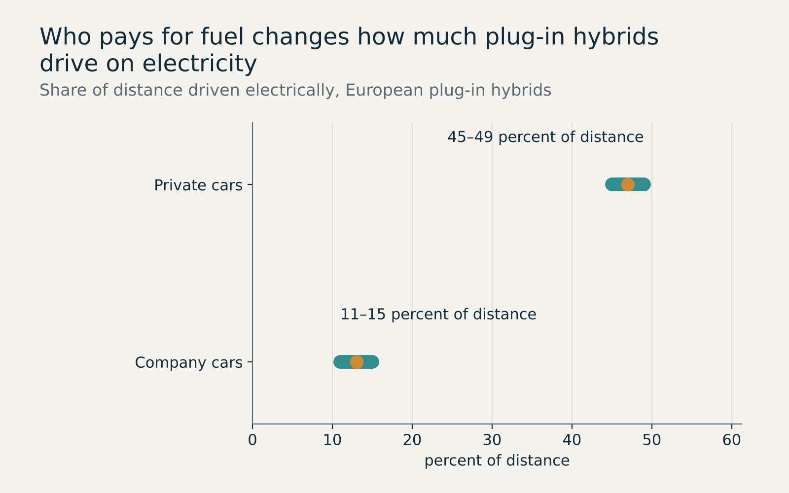

Most cars spend hours a day parked at work, overnight, at apartments and in driveways. That time is already spent, and it could be filling batteries. It doesn't take much power to do it: a slow 1.4-kilowatt outlet supplies about 80 to 86 percent of a 40-mile electric day during an eight-hour stay. Yet charging plans built around a few powerful posts keep buying speed that a parked car often can't use.

## The idea

Where cars park for hours, many slow, managed outlets should deliver more electric miles per dollar than a few fast posts. And the cars that use them best are plug-in hybrids with modest batteries: electricity for ordinary days, fuel for long trips.

Call it distributed electrification. Many cars carry modest packs sized for regular days and refill them slowly during stays they already make. An efficient hybrid drivetrain keeps the long trip. Managed charging keeps electrical upgrades small. Liquid fuel stays as a second energy path. It's a proposal to test, not a proven result, and it isn't a claim that plug-in hybrids should replace battery-electric cars.

## Why a smaller battery helps

Size the battery for the trips you make most days, not the longest trip of the year, and refill it while the car is parked.

A smaller pack uses less battery material, weighs less and costs less than a bigger one of the same chemistry, and you carry it on every mile. The whole car isn't automatically lighter or cheaper, because the engine and fuel system count too. But the battery gets a regular job instead of riding around half-used, and the hybrid underneath keeps saving fuel on days you never plug in. The cost is that a small pack runs out sooner, so it depends more on finding a working plug; when it doesn't, the engine does the work.

## Two energy paths

Here's what a pure efficiency case misses. Every car is a bet on which energy will be there when you need it.

| When this happens… | Gas only | Battery-electric only | Hybrid with a plug |
|---|---|---|---|
| Ordinary days | Gasoline every mile | Electricity every mile | Electricity when plugged in, gasoline for the rest |
| Grid or charging outage | Keeps going while pumps work | Only the charge already in the battery | Fuel in the tank, plus any charge |
| Fuel shortage or price spike | Fully exposed | Keeps going on charge | Electricity where it can plug in, fuel for the rest |

That's the case for energy independence and national security. Every grid-electric mile that replaces a fuel mile cuts petroleum demand and exposure to oil-supply shocks and contested supply chains. A fleet that can run on either is harder to disrupt than one that runs on only one. Cars that can also burn domestically produced fuels, such as flex-fuel, add another layer, but only where those fuels and pumps exist.

It's also disaster preparedness for one household. If an outage knocks out charging, the fuel in the tank still gets you to family or supplies. If pumps or deliveries fail, a charged battery covers short trips.

The limits are real. Fuel pumps need electricity too, so one outage can stop both. Roads close. A charged battery-electric car also holds energy. And a tank is a capability, not a supply: it only helps if there's fuel to put in it.

## What slow charging can deliver

Take a modest pack aimed at 40 electric miles, the test point in a 35-to-50-mile band. At an illustrative consumption rate, that's about 12 kilowatt-hours from the battery, or 13 to 14 kilowatt-hours from the wall once charging losses are counted.

A parked car has hours to collect that. At 3.3 kilowatts it takes about four hours. At 1.4 kilowatts, about what an ordinary 120-volt outlet delivers, an eight-hour stay still supplies about 80 to 86 percent of it. A busy shared lot can turn a Level 2 outlet down to that same rate. And a partial refill is fine: when the battery runs low, the engine takes over.

*A worked example, not a measured vehicle; real consumption varies a lot by car. Our estimate; assumptions under How we got these numbers.*

## Share the power, not the plug

Every space can get a standard Level 2 outlet. What limits a lot is the total power its electrical connection can carry, and a load-management controller handles that. It measures what the site is drawing and sets each car's charging rate so the total stays inside the connection. When few cars charge, each gets more; when many do, each gets less.

Picture a small workplace lot: ten spaces sharing one 33-kilowatt connection. With every car charging at once, each still gets 3.3 kilowatts, more than twice the 1.4 kilowatts in the example above. Planners at the National Renewable Energy Laboratory (NREL) call this matching of charging speed to parking time "right-speeding".

Fast charging is the opposite bet: a lot of power at a few posts. A parked car often doesn't need it. A plug-in hybrid that charges only from AC outlets can't use a DC fast port at all, and on AC its own onboard charger sets the pace. And it's expensive. NREL's model inputs put a commercial Level 2 port at $4,400 to $10,600, hardware plus installation, and a 150-kilowatt DC fast port at $112,200 to $196,200, roughly 11 to 45 times as much per port. These are historical model inputs, not current installation quotes, and they leave out utility upgrades, energy bills and repairs. They show why slow charging could win per dollar, not that it does. They're also for commercial Level 2 and DC fast ports, not for an ordinary 120-volt outlet.

*Installed cost per port, hardware plus installation, from national model inputs. Source: National Renewable Energy Laboratory.*

They also price one charger at a time, not a parking lot of managed outlets with its wiring, controller and billing. That all-in cost is what the pilot has to find.

## How big should the battery be?

According to the International Energy Agency, the average U.S. battery-electric car sold in 2025 carried 90 kWh of battery, and the average plug-in hybrid less than 20 kWh. A big pack covers the rare long day and sits partly unused on ordinary ones.

The trade-off runs both ways. A smaller pack needs charging more often and depends more on finding a working plug. A bigger one can go several days between charges and gives people with irregular driving more slack.

So the number to score is electric miles per kilowatt-hour of installed battery. Nobody has measured it for this setup, and the best pack size is an open question: around 10, 15, 20 or 30 kWh, depending on daily driving, charging access and the car.

Here's the logic, car for car. Split 60 kWh into four 15 kWh packs and you equip four plug-in hybrids instead of one battery-electric car. If each of the four plug-in hybrids travels the same distance as the battery-electric car, the four deliver more electric miles per kilowatt-hour of installed battery when their average engine-off share exceeds 25 percent. That's car for car, not equal total travel: together, the four also drive four times as far. For the same number of cars, a million 20 kWh plug-in hybrids install about 73 percent less battery than a million 75 kWh battery-electric cars. That counts battery, not electric miles or fuel saved.

## The catch: people have to plug in

Here's the fair pushback. In a European study, private plug-in hybrids drove 45 to 49 percent of their distance on electricity. Company cars, where someone else usually pays for fuel, managed 11 to 15 percent.

*Real-world electric driving share from a European study of plug-in hybrids; older, mixed datasets. Source: International Council on Clean Transportation.*

A North American manufacturer sample looks better: RAV4 Prime owners charged on 70 percent of driving days. But charging often isn't the same as driving on electricity. And using up the grid charge isn't the same as driving with the engine off: European fleet data show cars still burning fuel while they do it.

The hybrid underneath isn't in doubt. Regenerative braking, motor assistance and stop/start save fuel with no plug at all. What has to earn its keep is the extra plug and battery, so the test has to measure what drivers do, not just what the hardware can do.

## The fair rivals

The obvious alternative is an efficient hybrid with no plug. It keeps every hybrid gain without the premium. At launch, the 2026 Prius plug-in SE cost $5,225 more than the Prius hybrid LE, going by base prices rather than what buyers actually paid. Wherever charging is missing or ignored, the plain hybrid wins.

The other rival is a right-sized battery-electric car on the same outlets. An EU life-cycle model puts a medium plug-in hybrid sold in 2025 at 163 grams of CO2-equivalent per kilometre. That's well above the battery-electric car and not far below a plain hybrid. So we're not saying plug-in hybrids are cleaner per car. We're saying something about where scarce batteries and outlets do the most work.

## Who comes out ahead

Drivers who park for hours get cheaper everyday miles wherever electricity costs less than fuel, keep fuel for long trips, and never have to follow a charging rule. They choose the cheaper energy each day; the test checks whether they do.

Site owners can offer charging at many spaces without sizing the building's supply for every car at once, though they pay for the wiring, controller and repairs while drivers keep the fuel savings. Utilities get slow, spread-out load instead of sudden spikes, as long as the charging is managed.

Taxpayers could get more for each dollar of support, because a modest pack costs less per car and a fixed budget reaches more households. But a smaller pack doesn't by itself set the payment or prove more fuel saved per dollar. Support has to pay for extra electric miles actually driven, not for battery size, and be compared against plain hybrids and battery-electric cars doing the same job.

## Why this hasn't happened yet

Three things stand in the way, and none of them is physics. Plug-in hybrids have often gone unplugged, especially where an employer pays for the fuel. The building owner pays for the outlets while the driver saves on fuel, so the person who pays isn't necessarily the person who benefits. And there's no reliable all-in price yet for a lot full of managed outlets; that takes real site bids.

## How we'd know

Run a logged pilot for about 90 days at comparable sites where cars sit for hours, then follow up across seasons. One arm gets fewer, higher-power AC outlets. The other gets more low-power or managed outlets for a comparable all-in budget, priced from real bids. Battery-electric cars and plain hybrids join for comparison. Nobody is told to charge.

The many-outlet arm wins if it delivers more engine-off electric miles per all-in dollar, with refills completing and the site's peak staying inside budget. The idea dies for that kind of site if the fewer-outlet arm delivers equal or more useful electric travel per all-in dollar, if the plug doesn't earn its cost against matched hybrids, or if battery-electric cars meet the same need at lower complete cost.

## Where it breaks

The biggest risk is behaviour, not physics. If drivers don't plug in, or an employer pays for their fuel, the outlet and the battery are wasted money. Cold, short stays and shared power can also cut the refill short.

If you run a parking lot where cars sit for hours, get bids for both setups, run the logged comparison, and publish the electric miles per dollar, even if the fast posts win.

## How we got these numbers

**Published:** NREL's per-port cost ranges; Toyota's Prius launch prices; the IEA's 2025 battery averages; the European and North American plug-in studies; the EU life-cycle figure.

**Our estimates and illustrations:** the 35-to-50-mile band and the 40-mile test point; the worked example (12 kWh from the battery, 13 to 14 kWh from the wall, 80 to 86 percent from an eight-hour stay at 1.4 kilowatts), which assumes an illustrative consumption rate and 86 to 92 percent charging efficiency; the ten-space lot sharing 33 kilowatts; the 11-to-45-times cost ratio; the four-packs comparison (car for car, each driving the same distance) and the million-car comparison; the $5,225 price gap, which subtracts two launch prices; and the 90-day pilot length. Real consumption varies a lot by car.

---

[Read the full lab card](https://github.com/Idea-Shelf-Labs/idea-shelf/blob/main/cards/phev-first.md)

## Sources

- [S1] Federal Highway Administration, U.S. Department of Transportation, "Summary of Travel Trends: 2022 National Household Travel Survey (FHWA-HPL-24-009)", 2024-01. https://nhts.ornl.gov/assets/2022/pub/2022_NHTS_Summary_Travel_Trends.pdf
- [S2] Toyota Motor North America, "Toyota Prius Plug-in Hybrid Gets Edgier with New Nightshade Edition", 2025-06-16. https://pressroom.toyota.com/toyota-prius-plug-in-hybrid-gets-edgier-with-new-nightshade-edition/
- [S3] National Renewable Energy Laboratory (now National Laboratory of the Rockies), U.S. Department of Energy, "The 2030 National Charging Network: Estimating U.S. Light-Duty Demand for Electric Vehicle Charging Infrastructure (NREL/TP-5400-85654)", 2023-06. https://docs.nlr.gov/docs/fy23osti/85654.pdf
- [S4] Fraunhofer ISI, Öko-Institut and ifeu, "Regulatory adjustments for plug-in hybrid vehicles in Europe", 2026-02-18. https://publica-rest.fraunhofer.de/server/api/core/bitstreams/ac662473-acb6-462a-900d-b7066eb460c8/content
- [S5] Toyota Motor North America, "Do Plug-In Hybrid Owners Actually Plug In?", 2026-05-20. https://pressroom.toyota.com/do-plug-in-hybrid-owners-actually-plug-in/
- [S6] SAE International, "Identifying Patterns of Real-World Charging Frequency for a Sample of Plug-In Hybrid Electric Vehicles in North America (SAE 2026-01-0429)", 2026-04-07. https://saemobilus.sae.org/papers/identifying-patterns-real-world-charging-frequency-a-sample-plug-hybrid-electric-vehicles-north-america-2026-01-0429
- [S7] International Council on Clean Transportation and Fraunhofer ISI, "Real-world usage of plug-in hybrid vehicles in Europe: A 2022 update on fuel consumption, electric driving, and CO2 emissions", 2022. https://publica.fraunhofer.de/entities/publication/f7607ab2-d7d2-42dd-80fe-2cd229fa1b51
- [S8] International Energy Agency, "Global EV Outlook 2026: Electric vehicle batteries", 2026. https://www.iea.org/reports/global-ev-outlook-2026/electric-vehicle-batteries
- [S9] Toyota Motor Corporation, "Toyota Promotes Global Vehicle Electrification by Providing Nearly 24,000 Licenses Royalty-Free", 2019-04-03. https://global.toyota/en/newsroom/corporate/27512455.html
- [S10] Toyota Motor North America, "Electrified Trailblazer: The Toyota Prius Celebrates 25 Years in the U.S.", 2025-06-16. https://pressroom.toyota.com/electrified-trailblazer-the-toyota-prius-celebrates-25-years-in-the-u-s/
- [S11] International Council on Clean Transportation, "Life-cycle greenhouse gas emissions from passenger cars in the European Union: A 2025 update and key factors to consider", 2025-07-08. https://theicct.org/publication/electric-cars-life-cycle-analysis-emissions-europe-jul25/
- [S12] Toyota (GB), Toyota UK Magazine, "Why does Toyota use Atkinson cycle engines?", 2015-01-14. https://mag.toyota.co.uk/toyota-use-atkinson-cycle-engines/
- [S13] U.S. Department of Energy, Alternative Fuels Data Center, "Hybrid Electric Vehicles", undated. https://afdc.energy.gov/vehicles/electric-basics-hev
- [S14] U.S. Department of Energy, Alternative Fuels Data Center, "Electric Vehicle Benefits and Considerations", undated. https://afdc.energy.gov/fuels/electricity-benefits
- [S15] U.S. Energy Information Administration, "Weather and other events can cause disruptions to gasoline infrastructure and supply", 2013-02-01. https://www.eia.gov/TodayinEnergy/detail.php?id=9811
- [S16] MENNEKES, "Wallboxes and charging columns with load management", undated. https://www.mennekes.org/emobility/products/load-balancing/
- [S17] U.S. Department of Energy, Alternative Fuels Data Center, "Workplace Charging for Electric Vehicles", undated. https://afdc.energy.gov/fuels/electricity-charging-workplace
