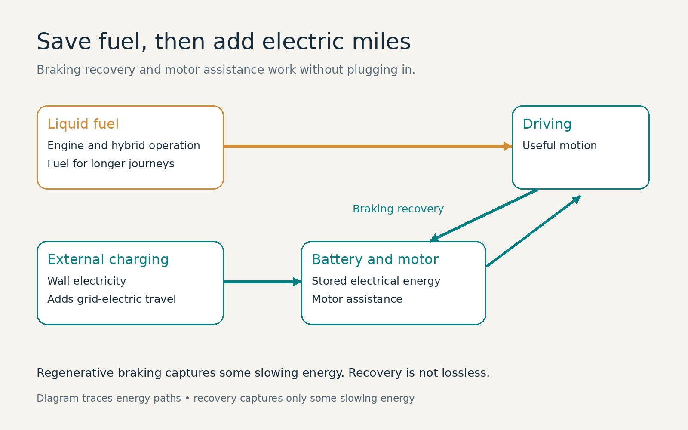

A modest battery can cover the daily miles. Gas can handle the long trip. Your parking space brings the two together.

If your car sits for hours at work, at home, or overnight, that time can help fuel the next journey. A plug beside the space turns a long stay into a charging opportunity. You get energy while you do something else, without sizing the battery around your longest trip.

Take a simple example. Eight hours at a steady 1.4 kilowatts supplies 11.2 kilowatt-hours from the wall—most of the roughly 13–14 kilowatt-hours needed for about 40 electric miles in this example. The hybrid engine and fuel tank remain for travel beyond the electric range.

That combination gives you more than another way to lower an energy bill. An efficient hybrid, a modest plug-in battery, and reliable charging can also give your household more options during a disruption. Across a fleet, useful electric miles can reduce petroleum demand while smaller packs reduce the battery capacity each car needs.

Eight hours at a steady 1.4 kilowatts supplies 11.2 kilowatt-hours from the wall—most of the example’s 13–14-kilowatt-hour refill. Assumptions: about 40 miles, 0.30 kilowatt-hours per mile of battery output, and 86–92% charging efficiency.

## Why a smaller battery helps

A smaller pack uses less battery material, weighs less, and costs less than a larger pack with comparable chemistry and engineering. You carry that smaller pack on every journey. Count the engine and fuel system too when comparing whole cars, rather than treating the pack saving as the whole purchase decision.

The engine keeps longer journeys possible without making the battery cover all their miles. Daily trips can use electricity when it makes sense; fuel can cover travel beyond the grid charge. That gives you room to choose a battery for the journeys you repeat, instead of carrying enough battery for every possible journey.

The hybrid architecture also improves how the engine operates. Regenerative braking, motor assistance, and reduced idling save fuel even on days you never plug in. Charging adds electric travel to those benefits.

For your household, that means the battery can have a regular job without taking responsibility for every trip. A dependable plug at home or work can replenish it between journeys. Your routes, weather, and available charging determine how much of your driving it covers.

The hybrid drivetrain saves fuel through braking recovery, motor assistance, engine management, and reduced idling. Plugging in adds grid-electric travel.

## Charging becomes simpler

A modest refill can fit a long parking stay. That changes the infrastructure question: could more accessible outlets deliver more electric miles per dollar than a few faster posts? At a workplace or apartment lot, a plug you can reach and rely on may matter more than a charger with a higher headline power rating.

Managed sharing lets the cars use a common power budget. Imagine up to 33 kilowatts across ten ports: an even allocation gives each 3.3 kilowatts where the electrical layout and cars allow it. As cars finish, leave, or draw less, the controller can offer spare capacity to others.

A car that can accept more power can then finish sooner than under a fixed allowance. The onboard charger, outlet, cable, and connection set the individual limit. The 33 kilowatts belongs to the group, rather than one plug-in hybrid.

Partial charging is fine. After you use the grid charge, the hybrid drivetrain still offers fuel range, so every parking visit need not end with a full battery. Collect the energy that fits your stay and keep moving when you need to leave.

A shared 33-kilowatt charging pool can offer ten ports an even 3.3-kilowatt allocation where hardware and phases permit. As demand falls, the controller can offer spare capacity to other cars. Ports, connections, and onboard chargers limit actual draw.

## Resilience and choice

Suppose a local outage interrupts charging, but your car already holds fuel. The hybrid drivetrain gives you another way to make a necessary trip. You might need to check on family or reach supplies; the value comes from energy already onboard, rather than finding a working charger first.

Now reverse the situation. If local pumps or fuel deliveries become unavailable, a charged battery can support electric trips where the car allows them. A working plug at home or another accessible location can offer a different route to replenishment while fuel access remains difficult.

That distinction matters when you plan for an emergency: stored energy gets you started, while access to replenishment determines what you can keep doing. Check the charge, fuel, and routes you could use before you need them. The car gives you choices between energy paths, rather than asking you to depend on the same refill for every journey.

Those choices have limits that belong in the same plan. An outage can disable charging and fuel pumps together, roads can close, and supplies can run out. An already-charged battery-electric car also holds energy, an efficient hybrid has fuel range, and a plug-in battery alone does not provide home backup power.

## Benefits beyond your own driveway

When grid-electric miles replace fuel-driven miles, the benefit reaches beyond the driver buying the charge. Those miles can reduce petroleum demand and exposure to petroleum supply disruptions. That is a practical national-security benefit: less ordinary mobility tied to the same fuel supply, without requiring every car to rely entirely on electricity.

A fleet with access to fuel and charging also has different ways to meet travel needs as conditions change. The benefit comes from available choices and the travel those choices support. More plug-in sales alone cannot tell you how much fuel the fleet displaces or how it performs through an interruption.

Smaller packs offer another public benefit: a given amount of battery capacity can equip more vehicles than if each carries a larger pack. Under comparable chemistry and engineering, that also lowers battery material requirements per vehicle. Actual charging, extra engines, and chemistry-specific materials decide whether that allocation makes better use of constrained resources.

Accessible outlets and managed power tackle a different constraint: charging infrastructure. Sharing available headroom can put spare capacity to work for cars that can accept it, while more usable outlets give parked cars more opportunities to connect. Judge the public value by travel supported, fuel displaced, actual site costs, and peak demand, rather than counting plugs alone.

## Make public support go further

Public support should make room for modest-battery plug-in hybrids and dependable charging, rather than treating a large pack as the measure of a car’s public value. If support and program costs per vehicle are lower, a fixed budget can help more households. Judge that spending by useful electric miles and petroleum displaced.

Compare it with support for smaller battery-electric cars, efficient hybrids, charging access, and other ways to meet the same travel needs. Count the extra electric travel and fuel savings the support actually causes, beyond what people would buy and drive anyway. Longer electric range can serve people well too; payment amounts, eligibility, and battery-size rules still need a decision.

## Let prices help people choose

For you, the immediate calculation is cost per mile. Divide the gasoline price per gallon by actual hybrid-mode miles per gallon. For engine-off electric driving, multiply wall electricity per mile by the price per kilowatt-hour, then spread session or extra parking fees over the miles that charge supplies.

If you pay for both fuels, cheaper electricity gives you a reason to plug in. If an employer buys gas while you pay for charging, the decision changes. Clear prices and dependable access let you choose the energy that suits the journey.

The ownership bill matters too. Count purchase cost minus resale value, plus loan interest and fees, maintenance, insurance, and charging equipment. Low-cost electric miles help only if the extra battery and plug earn their cost over the time you own the car.

Those decisions can guide improvements over time. Automakers can learn which battery sizes buyers choose and use; site owners can compare extra outlets, higher power, and better sharing. Feedback gives them something concrete to improve without prescribing the same car or charging habit for everyone.

## What the comparison needs

An efficient non-plug-in hybrid can win when charging is inconvenient or the extra battery never earns its cost. A well-sized battery-electric car can win when it meets the same needs at lower total cost or impact. The test is whether the plug, battery, and outlets earn their cost in useful travel.

Try the comparison where cars already sit for hours. A 90-day pilot could compare more managed lower-power compatible AC outlets against fewer higher-power outlets under similar budgets. Track electric miles per infrastructure dollar, fuel displaced, peak demand, and what people choose when prices and convenience are clear.

For an individual buyer the starting point is simpler. Look at where the car already parks for hours. Work out what an outlet there could supply before departure, what those miles would cost, and what range is still needed for longer trips. A modest battery, reliable access, and an efficient hybrid drivetrain may fit that life better than sizing the car around the longest journey it might ever take.

## How we got these numbers

**Published mechanisms.** Hybrid operation and managed charging follow public engineering guidance. Driver response, site economics, and disruption performance still need measurement.

**Calculated example.** Eight hours at 1.4 kilowatts supplies 11.2 kilowatt-hours. A 33-kilowatt pool divided across ten ports gives a 3.3-kilowatt allocation where equipment and phase limits permit.

**Assumptions.** About 40 miles at 0.30 kilowatt-hours per mile uses 12 kilowatt-hours of battery output. Assumed 86–92% charging efficiency gives about 13–14 kilowatt-hours at the wall. The 90-day pilot starts the comparison; seasonal follow-up needs more time.

---

## Sources

- U.S. Department of Energy, Alternative Fuels Data Center, “Hybrid Electric Vehicles”: https://afdc.energy.gov/vehicles/electric-basics-hev
- U.S. Department of Energy, Alternative Fuels Data Center, “Workplace Charging for Electric Vehicles”: https://afdc.energy.gov/fuels/electricity-charging-workplace
- MENNEKES, “Wallboxes and charging columns with load management,” undated manufacturer explanation: https://www.mennekes.org/emobility/products/load-balancing/

## Illustration credits

- Original explanatory diagram. Mechanisms: U.S. Department of Energy, Alternative Fuels Data Center, Hybrid Electric Vehicles.
- Original diagram; illustrative arithmetic and assumptions described in How we got these numbers.
- Original diagram. Dynamic-current distribution mechanism: MENNEKES, Wallboxes and charging columns with load management. Budget and allocation are illustrative.
