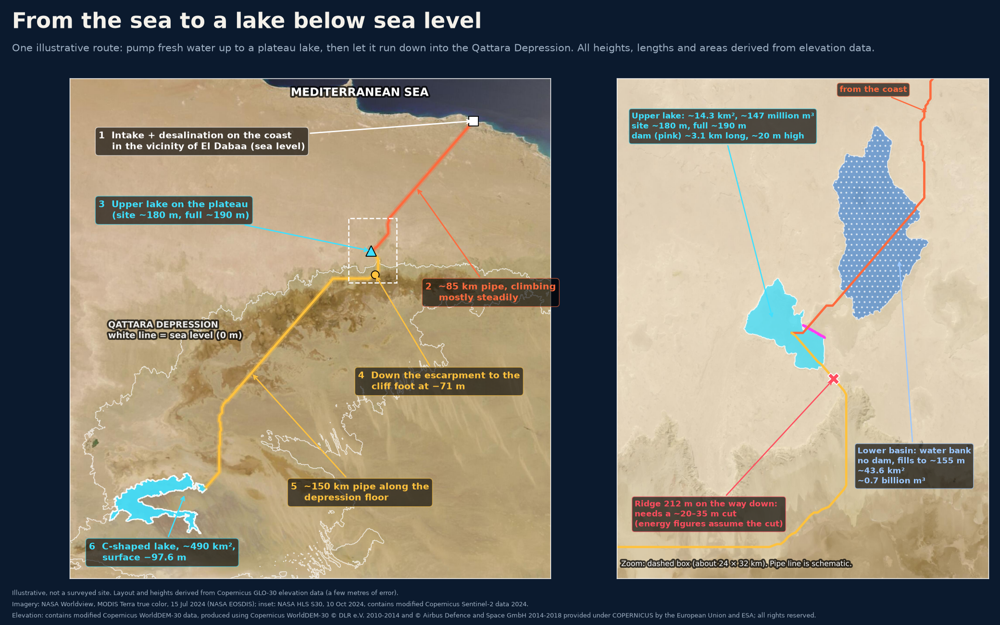
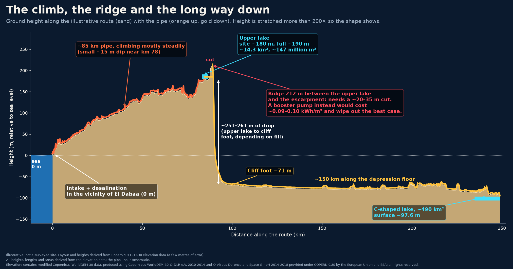
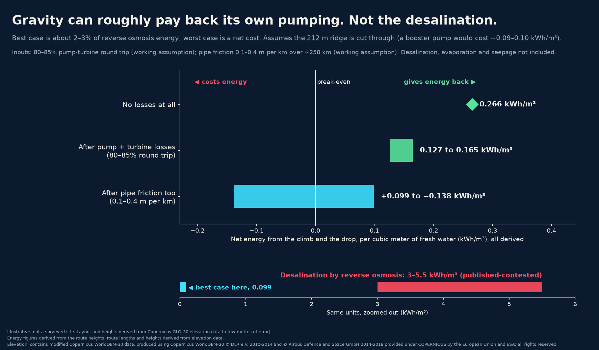
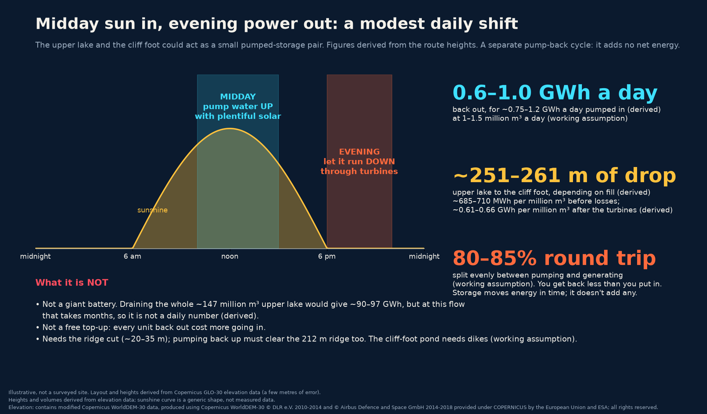
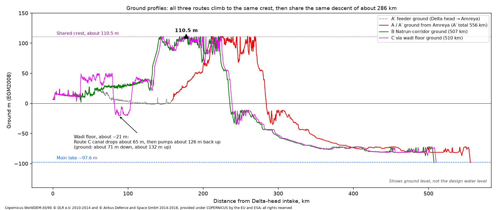

*One illustrative route across Egypt's Western Desert: a drop that could pay back its own pumping, cheap heat for desalination, and fresh water that could cover today's salt and sand.*

At midday, pumps would push fresh water up onto a plateau. At night it would run back down a cliff, through turbines, toward a lake that sits below sea level.

It sounds like a machine that runs itself. It isn't. But the geography does more of the work than you might expect, and the numbers show where the hard part is.

## What it could add up to

- **Water that ends up downhill.** The final lake sits at about −97.6 m, so the drop can pay back the pumping.
- **Cheap heat.** A power plant's cooling-water heat, otherwise sent back to the sea, is near free. It becomes the base heat for desalination.
- **Storage on the route.** The lake on the plateau can shift solar power into the evening.
- **Fresh water and a reserve in the desert.** Lakes, a stored buffer, and room for farms and wildlife.

## The idea

Northwestern Egypt holds a huge dip in the desert, the Qattara Depression. About 19,605 km² of it lies below sea level, and its edge comes within about 56 km of the Mediterranean.

For a century, engineers dreamed of letting the sea pour in to make power. This idea asks for fresh water instead, made on the coast and kept as a lake.

The claim is simple: run as one system, a nuclear plant's spare heat, spare electricity for desalination, a solar-clad pipe over the high ground, and turbines on the way down are *designed to* cut the net energy cost of filling a below-sea-level basin with fresh water.

This isn't a survey or a build plan. It's one illustrative layout. Heights and areas are estimated from satellite elevation data that carries a few metres of error.

## Follow the water

1. **The coast.** Intake and desalination sit on the coast in the vicinity of El Dabaa, using the plant's cooling-water heat piped a few kilometres. It is an illustrative site, chosen only to score the idea. It implies no endorsement by the plant or its owners.
2. **The climb.** A pipe of roughly 85 km carries the water inland, rising mostly steadily, with one dip of about 15 m near km 78.
3. **The upper lake.** The ground sits at about 180 m and the full lake at about 190 m. A dam about 3.1 km long would hold roughly 14.3 km² and about 147 million m³.
4. **The ridge.** More on this below.
5. **The cliff.** The water drops down the escarpment to about −71 m at the cliff foot, a fall of about 251–261 m depending on how full the upper lake is.
6. **The lake.** About 150 km farther along the depression floor, a C-shaped pocket in the southwest would hold 490 km² of water at about −97.6 m, roughly the size of Lake Tahoe.

## The ridge in the way

About 4.1 km south of the upper lake, on the way down, the elevation data shows a ridge rising to about 212 m, higher than the full lake. There are two ways past it.

- **Cut through it** with a channel or tunnel about 20–35 m deep (about 22–32 m between a full and a low lake). A one-time job. We haven't costed it.
- **Pump over it.** A booster would cost about 0.09–0.10 kWh per cubic metre, forever, which wipes out the best case below.

Every energy figure here assumes the cut.

## The drop can pay its own way

Each metre of height is worth about 0.002725 kWh per cubic metre of water. Lift water to about 180 m, let it fall to −97.6 m, and the drop below sea level is the profit.

Before friction, the whole trip comes out ahead. With perfect machines, about 0.266 kWh/m³ comes back, net. Assuming pumps and turbines manage an 80–85% round trip, the net is still about 0.127–0.165 kWh/m³.

Pipe friction decides how much is left. Assuming 0.1–0.4 m of lost head per km over about 250 km of pipe, the result spans roughly +0.099 to −0.138 kWh/m³. A wide, smooth pipe keeps a small gain. A narrow one turns it into a small loss. Pipe size is a cost trade.

Reverse osmosis (RO) desalination, by comparison, takes about 3–5.5 kWh/m³, though published estimates vary. Gravity can roughly pay back its own pumping. At best that covers about 2–3% of RO's energy. It does not pay for desalination. At best it removes the usual energy penalty for moving water inland and uphill. With a narrow pipe it leaves a small one.

## People already pump water over mountains

Since 1941, the Colorado River Aqueduct has run 242 miles, about 390 km, from the Colorado River to Southern California. Five pumping plants lift the water a combined 1,617 feet, about 490 m. Published estimates put the energy at about 2,000 kWh per acre-foot, roughly 1.6 kWh per cubic metre.

California's State Water Project climbs higher. One pumping plant at the foot of the Tehachapi Mountains lifts water 1,926 feet, about 590 m, in a single step. Water delivered from the Delta to the end of its East Branch takes about 3,236 kWh per acre-foot, net of what its own hydro plants recover, roughly 2.6 kWh/m³. That covers the whole trip, not just the Tehachapi lift.

Those systems spend most of that energy for good, because their water ends up higher than it started. Here the water ends up lower, so the climb can be paid back. The comparison is about direction, not scale.

## Cheap heat for the water

Desalination leans on three other things: spare plant heat for a thermal method called multi-effect distillation (MED), spare electricity for RO, and timing each machine to run when its energy costs least. The goal, still to be tested, is a plant that buys little or no outside electricity.

### Heat that would be lost anyway

A nuclear plant's condenser cooling water typically comes out at about 30–40 °C. Normally that heat goes back to the sea. Here it becomes MED's base heat. By design, no steam is taken, so the plant's safety basis is unchanged.

Running the cooling water a few degrees warmer is optional, up to the operator, and by our estimate would cost about 1–2% of output. Published studies put the loss at about 0.4–0.45% of electrical output per °C, over a 2–5 °C rise.

### Solar tops it up

MED needs about 65–70 °C, so the warm water needs a lift in temperature. Heat pumps do that, running on midday solar surplus. We assume each unit of electricity moves 3–5 units of heat (a "COP" of 3–5). The published commercial average is about 3.3.

So most of the heat MED uses comes from water headed back to the sea. The electricity pays only for the top-up.

In the evening the plan sends power to the grid or to RO. Using some of the evening release to keep the heat pumps running is an option we haven't modeled. It is stored midday solar, not extra energy.

The top-up is where the cost sits. MED uses about 64–108 kWh of heat per m³, though published figures vary. Making all of that heat with heat pumps would take about 13–36 kWh of electricity per m³, roughly 2–12 times RO's 3–5.5. So MED earns its place by soaking up cheap surplus power, not by replacing RO. The split between MED and RO is the sizing question we haven't modeled yet. It is cheap heat, not free heat.

## Storage on top: an evening shift

As a separate cycle, the upper lake and a pond at the cliff foot, assuming it can be ringed with dikes, could work as a small pumped-storage pair: pump water up with midday solar, let it run down in the evening.

Each million m³ falling 251–261 m is worth about 685–710 MWh before losses, or about 0.61–0.66 GWh after the turbines. Assuming 1–1.5 million m³ a day and an 80–85% round trip split evenly between pumping and generating, that is about 0.6–1.0 GWh a day back out for about 0.75–1.2 GWh pumped in.

The storage step on its own returns about 80–85% of what goes in. That is close to the roughly 80% the US Department of Energy gives for new pumped-storage plants. Storage moves energy in time and adds none of its own. The net gain above comes from the drop below sea level.

Before pipe friction, the drop's daily surplus is about the same size as the storage cycle's daily losses. With a narrow pipe, friction erases it.

That is a modest evening shift, not a giant battery. Draining the whole upper lake, about 147 million m³, would give roughly 90–97 GWh, but at that flow it would take months. And pumping back up has to clear the same 212 m ridge.

## Fresh water and life in the desert

The point of all this pumping is fresh water. The depression floor today is salt pans, salt marsh, and sand. The goal is a freshwater lake of about 490 km². The first step is smaller: one large plant pair and a lake of about 180–270 km².

The pipe, the upper lake, the water bank, and the final lake all hold desalinated water. Each body of water could support farming on its edges, habitat for wildlife, and more humidity in the local air. Each counts only once water quality and retention are shown.

A freshwater lake has to be managed to stay that way. With no outflow, the lake loses water mainly to evaporation, plus some seepage. Evaporation leaves the salt behind, so the lake gets saltier over time unless some water is bled off, for example to irrigate salt-tolerant crops on its edge, an idea we haven't tested. Seepage can't count as bleed-off. It is uncontrolled, and it puts wells and Siwa at risk.

Evaporation is the lake's biggest running cost. Assuming about 5,500 m³ per km² per day, holding 490 km² steady takes about 2.7 million m³ a day. That same loss is where the extra humidity comes from.

The upper lake holds about 147 million m³ when full, roughly three to five months of one large plant pair's output, or about two months at the full goal. That holds only when the lake isn't being cycled for storage. About 9.5 km north-northeast of it sits a natural closed basin. With no dam, it would fill to about 155 m, covering about 43.6 km² and holding about 0.7 billion m³. Together they could act as a reserve for a plant outage or a dry spell.

With only about 56 m of height between it and the upper lake, the water bank is weak as power storage.

## Washing out the old salt

Over time, the lake would settle to fresh water at about 1,000 mg/L, the usual limit for fresh water. By our reading of FAO's guide, that gives full yields of barley, wheat, cotton, sugar beet, sorghum, date palm, and tomatoes. Maize, citrus, potatoes, and grapes lose up to a tenth of their yield. Beans, carrots, and onions struggle.

A bleed of about 1–3% of the inflow would hold that level with desalinated water alone, or about 11–12% in years with Nile water, by our estimate. It would water salt-tolerant edge farms of about 110 km², which drain by gravity into a salt cell of about 47–54 km² to the northeast.

We'd flush the old salt crust first, collecting brine in the deepest pocket and pumping it to the salt cell. By our estimate, a crust up to about 10 cm clears in about 2–4 rounds over 3–8 months. The flush doesn't need the Nile: by our estimate, about three to nine months of the desalination plants' full output could do it. Pumping the brine out takes about 55–190 GWh, once.

The biggest unknown is salty water in the sediment below, unmeasured and likely to seep out for years. So we'd accept roughly 1,500–3,000 mg/L early on, with a larger bleed. Settling near 1,000 could take decades in our simple model, depending on how much brine the floor holds. Field cores come first, to set the flush, the early salt level, and the bleed.

## What could come next: a link to the Nile

In surplus years only, a canal could carry a little Nile water to the main lake, by our assumption about 0.1–0.5 km³ a year.

By our estimate, the best route starts at the Delta head near Qanater. The river near Cairo carries about 170–240 mg/L of salt, by published measurements. The canal would skirt north of Wadi El Natrun and climb about 100–106 m to a saddle of about 110.5 m near Moghra. It then drops about 208 m to the lake through about five small hydro plants, about 507 km in all.

This water needs no desalination. As an open canal, it would net about +0.05 to +0.16 kWh/m³ by our estimate, against RO's 3–5.5. There is no storage.

A lined branch of about 18–20 km could let about 8,000–25,000 feddan of Wadi El Natrun farms pump less from an aquifer overdrawn by about 106 million m³ a year, by published estimates. A no-farm buffer of about 2.5 km would protect the natron lakes and bird area, and the branch would avoid the monasteries. It costs energy but rests the aquifer.

, the Wadi El Natrun branch, and the lake's salt plan.")

Toshka's lakes, filled by Nile overflow, turned salty and lost their fishery. The feed would need screening for schistosomiasis snails, and the canal lining against seepage toward Siwa.

A Nile feed would use only water that Egypt's own planners judge spare in a given year, after existing users, and would switch off otherwise. We haven't costed it or surveyed the route. It is an idea for a later study, not part of this design.

## Egypt already asked a different question

A government review, reported on 12 May 2026, rejected filling the depression with seawater. It judged several scenarios not feasible, including desalinating at the rim and piping water straight to users, and favored not using the depression as a reservoir at all. It named seepage into groundwater, saltier soil, harm to ecosystems including Siwa Oasis, overlap with oil and gas areas, and cost. This design uses fresh water, the plant's cooling-water heat, and a lake bed lined or tested before any fill. It is still a reservoir. It faces the same risks. It does not claim to overturn the review.

## The simpler rival

The strongest competitor is plain: desalinate on the coast and pipe the water straight to farms and towns. No climb, no ridge, no lake. This idea only beats it if a lasting freshwater lake is worth the extra pipe, the extra risk, and the water lost to the sky.

## What could go wrong

The main way it fails: the route cannot show a climb-and-drop, a brine plan, and a salt balance that support a lasting freshwater lake. The risks, in one place:

- **The ridge.** If the cut costs too much, a booster pump erases the best case.
- **Pipe friction.** A narrow pipe turns the small energy gain into a small loss.
- **Evaporation and seepage.** The 2.7 million m³ a day for the full lake takes, we assume, two to three large desalination plant pairs. The floor sits on sand and sandstone linked to an aquifer already pumped for farmland northeast of the depression, so fresh water could leak away.
- **Salt.** Fresh water dissolves salt from the floor. Without a liner or barrier, the lake would grow saltier over time, at a rate nobody has measured.
- **Brine and intake.** Desalination leaves salty brine and draws in sea life at the intake. Both have to be designed, costed, and permitted. The brine volume hasn't been worked out.
- **The environment.** Siwa Oasis lies just to the west. Any lake must not raise salt levels in nearby wells or groundwater.
- **Oil and gas.** The plateau holds producing fields, including Razzak, Alamein, and Abu Gharadig. We haven't mapped them against this route yet.
- **Cost.** There is no cost figure for this route yet.

## Your turn

Which would you build first: the lake on the plateau, the heat-pump desalination on the coast, or the simple pipe from the coast to the farms? Tell us why in the comments.

And if you know someone who always asks "why not just let the sea into the desert?", send them this. It is the short answer to why the fresh-water version is harder, and more interesting, than it looks.

## How we got these numbers

**Measured or published:** the depression's size and distance from the sea, Lake Tahoe's area, the 2026 review, the oil fields, the floor's makeup, RO and MED energy use, MED's temperature, cooling-water temperatures, the published output loss per °C (our 1–2% total is an estimate), and commercial heat-pump performance.

**Outside comparisons:** the California aqueduct lifts and energy figures, and the pumped-storage efficiency of new plants, are published figures for other systems, for scale only.

**Estimated from elevation data:** lengths, heights, drops, the ridge and its cut, lake areas and volumes, and the water bank. Energy and storage figures are our arithmetic on those heights.

**Future option:** the Nile route, lift, volumes, energy, the Wadi El Natrun branch and its salt figures are early estimates for a later study, drawn partly from published sources. They are not part of this design's numbers. How often a surplus year comes is unknown.

**Salt plan:** the 1,000 mg/L target, bleed, edge farms, salt cell and flush are our estimates. The crop limits are published (FAO). Upper limit for fresh water: USGS.

**Assumptions:** the layout, no steam taken, machine efficiency, pipe friction, heat-pump COP, storage flow and the cliff-foot pond, evaporation, the number of plant pairs, and a full lake about the size of Lake Tahoe.

---

*Maps and charts are illustrative, not a surveyed site. Heights, lengths and areas are derived from Copernicus GLO-30 elevation data, which carries a few metres of error. Imagery: NASA Worldview (MODIS Terra) and NASA HLS (contains modified Copernicus Sentinel-2 data). Elevation: contains modified Copernicus WorldDEM-30 data © DLR e.V. 2010–2014 and © Airbus Defence and Space GmbH 2014–2018, provided under COPERNICUS by the European Union and ESA; all rights reserved. The lake volume and parts of the Nile route analysis use Copernicus GLO-90. The saddle and Wadi El Natrun corridor use GLO-30. GLO-90: produced using Copernicus WorldDEM-90 © DLR e.V. 2010–2014 and © Airbus Defence and Space GmbH 2014–2018, provided under COPERNICUS by the European Union and ESA; all rights reserved.*

*Heat sources: cooling-water output loss per °C: Durmayaz & Sogut 2006, International Journal of Energy Research (https://onlinelibrary.wiley.com/doi/10.1002/er.1186); Ibrahim et al. 2014, Journal of Energy (https://doi.org/10.1155/2014/793908). Industrial heat-pump COP: Arpagaus et al. 2018, Energy (https://doi.org/10.1016/j.energy.2018.03.166).*

*Comparison sources: Colorado River Aqueduct length, five pumping plants, and 1,617 ft total lift: Metropolitan Water District of Southern California, Colorado River Aqueduct fact sheet, 2021 (https://www-admin.mwdh2o.com/media/ja5k5pcu/cra_fact-sheet-2021.pdf). About 2,000 kWh per acre-foot for Colorado River water: Wilkinson et al. 2006, ACEEE Summer Study, citing Metropolitan Water District 1996 (https://www.aceee.org/wp-content/uploads/proceedings-1980-2020/2006/SS06_Panel12_Paper14.pdf). State Water Project 1,926 ft single lift at the Tehachapis and 3,236 kWh per acre-foot to the end of the East Branch: California Energy Commission, California's Water-Energy Relationship, CEC-700-2005-011-SF, 2005 (https://cawaterlibrary.net/wp-content/uploads/2017/05/Californias-Water-Energy-Relationship.pdf). About 80% round trip for new pumped-storage plants: US Department of Energy, Technology Strategy Assessment: Pumped Storage Hydropower, 2023 (https://www.energy.gov/sites/default/files/2023-07/Technology%20Strategy%20Assessment%20-%20Pumped%20Storage%20Hydropower_0.pdf).*

*Nile and salt sources: Nile salinity near Cairo, about 173 mg/L at El-Kanater and about 240 mg/L at the Delta barrage in a 2001 survey: Nile River Water Quality Management Study (https://cpb-eu-w2.wpmucdn.com/sites.aub.edu.lb/dist/e/139/files/2017/03/Nile-RIver-Water-Quality-Management-Study-1.pdf). Toshka lakes: https://doi.org/10.3390/rs11020158 and USGS EROS Earthshots (https://eros.usgs.gov/earthshots/the-lakes-form). Snails, schistosomiasis, and water hyacinth: Dazo et al. 1966 (https://pmc.ncbi.nlm.nih.gov/articles/PMC2476091/) and PMID 10605512 (https://pubmed.ncbi.nlm.nih.gov/10605512/). Wadi El Natrun aquifer over-abstraction, about 106 million m³ a year: Journal of the Geological Society of India, 2018 (https://doi.org/10.1007/s12594-018-0986-7). Wadi El Natrun Important Bird Area: BirdLife DataZone (https://datazone.birdlife.org/site/factsheet/6197-wadi-el-natrun). Monasteries: UNESCO Tentative List 1827, The monasteries of the Arab Desert and Wadi Natrun (https://whc.unesco.org/en/tentativelists/1827/). Crop salt tolerance at full yield, converted from ECw to mg/L at ×640 by us: Ayers & Westcot, Water Quality for Agriculture, FAO Irrigation and Drainage Paper 29 Rev. 1, 1985 (https://www.fao.org/4/t0234e/t0234e00.htm). Salinity of desalinated water: DESWARE, Composition of Desalinated Water, distillate about 20–30 ppm (https://www.desware.net/sample-chapters/D02/D13-002.pdf); MHI Technical Review 46(1), 2009, second-pass RO at Rabigh about 13 mg/L (https://www.mhi.com/technology/review/sites/g/files/jwhtju2326/files/tr/pdf/e461/e461012.pdf). Fresh and slightly saline water classes: USGS Water Science School (https://www.usgs.gov/water-science-school/science/saline-water-and-salinity).*
